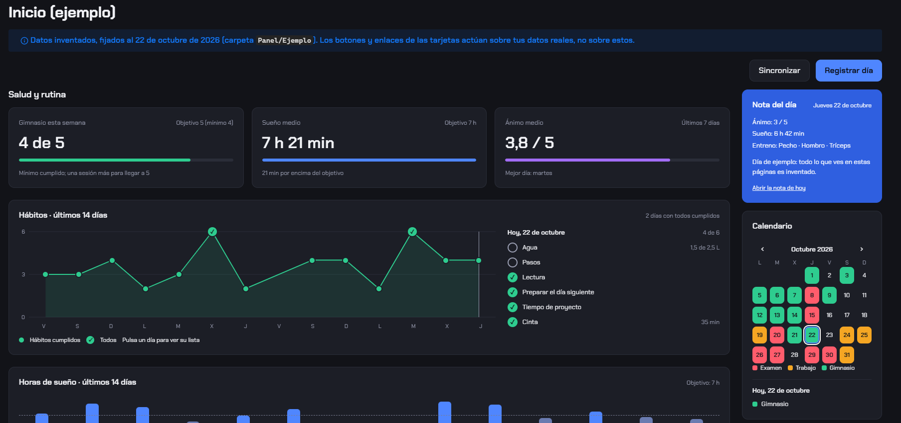
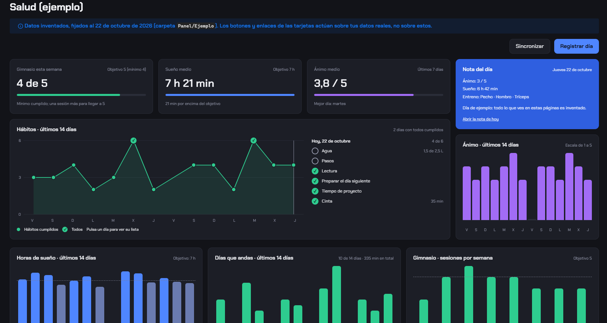
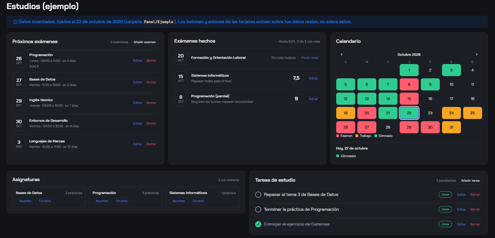
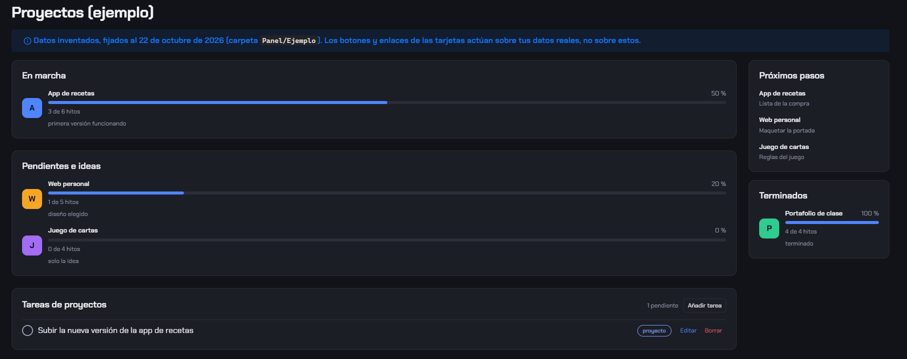
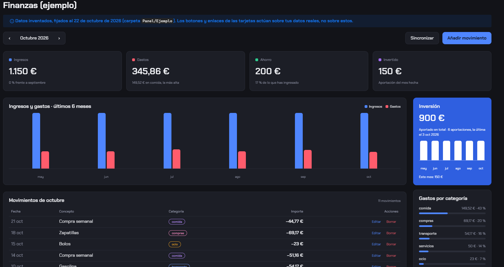
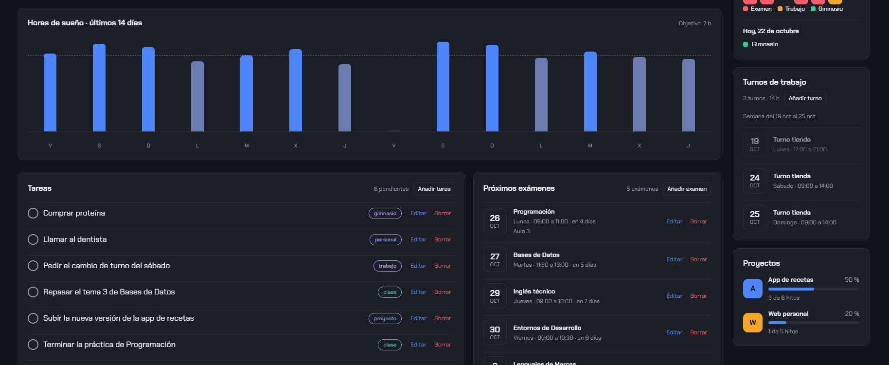
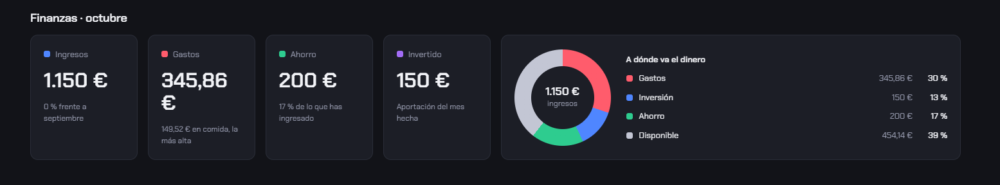
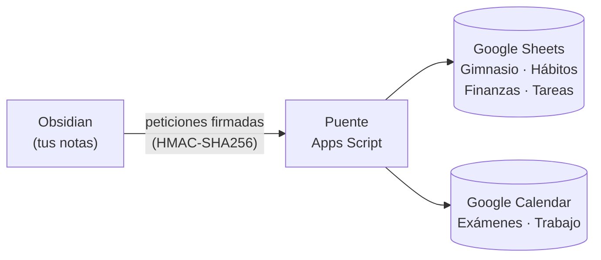

# Panel en Obsidian


Un panel de control de vida **dentro de Obsidian**: salud y hábitos, estudios, proyectos, tareas y finanzas en cinco páginas, con un estilo oscuro propio. Todo son notas de Markdown con propiedades, así que tus datos se quedan en tu bóveda, en texto plano, y cualquier herramienta (o una IA) puede leerlos.

Opcionalmente se sincroniza en los dos sentidos con **Google Sheets y Google Calendar** a través de un pequeño puente de Apps Script.



<details>
<summary>Más capturas (Salud, Estudios, Proyectos, Finanzas)</summary>








</details>

*Todas las capturas usan los datos de ejemplo que trae el repositorio.*

## Índice

- [Qué incluye](#qué-incluye)
- [Instalación (5 minutos)](#instalación-5-minutos)
- [Uso](#uso)
- [Configuración](#configuración)
- [Cómo se guardan los datos](#cómo-se-guardan-los-datos)
- [Sincronizar con Google (opcional)](#sincronizar-con-google-opcional)
- [Privacidad](#privacidad)
- [Estructura del repositorio](#estructura-del-repositorio)
- [Licencia y créditos](#licencia-y-créditos)

## Qué incluye

| Página | Qué muestra |
|---|---|
| **Inicio** | Gimnasio de la semana, sueño y ánimo medios, gráfica de hábitos de 14 días con la checklist de cada día, horas de sueño, tareas, próximos exámenes, resumen de finanzas, nota del día, calendario del mes, turnos de trabajo de la semana y proyectos. |
| **Salud** | Los mismos datos de salud, ánimo de 14 días, días que andas en la cinta y sesiones de gimnasio por semana. |
| **Estudios** | Próximos exámenes, exámenes hechos (con calificación y un apunte), calendario con el detalle de cada día, asignaturas con sus apuntes y prácticas, y tareas de clase. |
| **Proyectos** | Proyectos en marcha, pendientes, ideas y terminados, con una barra de progreso que sale de su plan de casillas, próximos pasos y tareas de proyecto. |
| **Finanzas** | Mes a mes: ingresos, gastos, ahorro e inversión, gráfica de 6 meses, movimientos, total invertido y gastos por categoría. |

Además trae **datos de ejemplo** (`Panel/Ejemplo`) y cinco páginas *Ejemplo - …* para ver el panel completo antes de meter nada tuyo.

## Instalación (5 minutos)

Necesitas [Obsidian](https://obsidian.md) (gratis).

1. **Descarga el repositorio:** botón verde **Code > Download ZIP** y descomprímelo donde quieras (o `git clone`).
2. En Obsidian: **Abrir otra bóveda > Abrir carpeta como bóveda** y elige la carpeta descargada.
3. Cuando Obsidian pregunte, pulsa **Confiar en el autor y activar los plugins**.
4. **Ajustes > Plugins de la comunidad > Explorar** e instala y activa **Dataview** y **QuickAdd**. Su configuración ya viene hecha (DataviewJS activado y las acciones del panel cargadas).
5. Comprueba que en **Ajustes > Apariencia > Fragmentos CSS** están activados `chakra-petch` y `panel`.
6. Abre la nota **Empieza aquí**.

> Las páginas `Panel/Panel - …` muestran **tus** datos, así que al principio salen vacías. Para ver cómo queda, abre las páginas `Panel/Ejemplo/Ejemplo - …`.

## Uso

- **Nota del día:** el plugin básico *Notas diarias* crea una por día en `Panel/Diario` con la plantilla del panel.
- **Acciones:** todo se añade con formularios de QuickAdd, desde los botones y enlaces de las tarjetas o con `Ctrl+P` > "QuickAdd: …".

| Acción | Para qué | ¿Necesita Google? |
|---|---|---|
| **Registrar dia** | Ánimo, sueño, entreno, cinta, agua, pasos, lectura, preparar el día siguiente, proyecto y notas, en un solo formulario | No |
| **Anadir / Editar / Borrar movimiento** | Ingresos, gastos, ahorro e inversión | No |
| **Anadir / Editar / Marcar / Borrar tarea** | Tareas con categoría | No |
| **Poner nota de examen** | Calificación y apunte de un examen ya hecho (se guardan solo en la nota) | No, aunque los exámenes llegan desde Google |
| **Anadir / Editar / Borrar examen** | Exámenes (se guardan en Google Calendar) | Sí |
| **Anadir turno** | Turnos de trabajo (se crean en Google Calendar) | Sí |
| **Configurar puente** y **Sincronizar** | Conectar con Google y traer o enviar los cambios | Sí |

Sin el puente, todo lo que no necesita Google funciona igual: se guarda en tus notas.

## Configuración

Los ajustes personales están en la nota **`Panel/Configuracion.md`**, no en el código:

| Propiedad | Qué cambia |
|---|---|
| `objetivo_gimnasio`, `minimo_gimnasio` | Sesiones por semana |
| `objetivo_sueno` | Horas de sueño por noche |
| `objetivo_agua` | Litros al día para dar por cumplido el hábito de agua |
| `titulo_turno` | Título que propone "Anadir turno" |
| `nombre_inversion` | Nombre en la tarjeta de inversión ("Inversión · …") |
| `asignaturas_sin_material` | Asignaturas que salen como "Sin material todavía" |

Los colores y el diseño están en `.obsidian/snippets/panel.css`.

## Cómo se guardan los datos

Una nota por cosa, con sus datos en las propiedades (YAML) de la nota:

| Carpeta | `tipo` | Propiedades principales |
|---|---|---|
| `Panel/Diario` | `nota-del-dia` | `fecha`, `animo` (1-5), `sueno_horas`, `entreno`, `pasos`, `agua_litros`, `lectura`, `preparar_dia`, `proyecto`, `cinta_min` |
| `Panel/Finanzas/Movimientos` | `movimiento` | `id`, `fecha`, `concepto`, `clase` (ingreso, gasto, ahorro o inversion), `categoria`, `cantidad` |
| `Panel/Tareas` | `tarea` | `id`, `tarea`, `categoria`, `hecha` |
| `Panel/Calendario` | `evento` | `id`, `titulo`, `fecha`, `inicio`, `fin`, `categoria` (examen o trabajo), `calificacion`, `apunte` |
| `Proyectos` | `proyecto` | `estado`, `situacion` (en-marcha, pendiente, idea o terminado) y una sección `## Plan para terminar` con casillas `- [ ]` |
| `Estudios` | `asignatura`, `apuntes`, `chuleta`, `practica` | `asignatura` (el nombre de la asignatura a la que pertenece) |

Mira cualquier nota de `Panel/Ejemplo` para ver el formato exacto.

## Sincronizar con Google (opcional)

El puente es un script de Google Apps Script que vive en **tu** cuenta de Google. Conecta el panel con una hoja de cálculo (salud, finanzas y tareas) y con dos calendarios (exámenes y turnos de trabajo), en los dos sentidos.



- Cada petición va **firmada con un secreto** que solo está en tu Obsidian y en tu script: sin él, el puente no responde.
- Una función, `prepararTodo`, crea la hoja, sus pestañas y los calendarios por ti.
- Guía paso a paso y detalles de seguridad: **[puente/README.md](puente/README.md)**.

## Privacidad

- Tus datos están solo en tu bóveda (y en tu cuenta de Google si usas el puente). El panel no envía nada a ningún otro sitio.
- El archivo con el secreto del puente (`Panel/Scripts/.puente/`) y tus carpetas de datos están en el `.gitignore`: si usas la bóveda con Git, no se suben por accidente.

## Estructura del repositorio

```
.obsidian/          ajustes de Obsidian, estilos (snippets) y configuración de Dataview y QuickAdd
Panel/
├── Panel - *.md    las cinco páginas del panel
├── Configuracion.md  tus ajustes
├── Ejemplo/        datos y páginas de ejemplo (puedes borrarlo cuando quieras)
├── Plantillas/     plantilla de la nota del día
├── Scripts/        todo el código: una vista de Dataview por página y las acciones de QuickAdd (panel_lib.js)
├── Diario/ Finanzas/ Tareas/ Calendario/   tus datos
Proyectos/ Estudios/  tus proyectos y tus apuntes
puente/             el puente con Google (Puente.gs y su guía)
```

## Licencia y créditos

- Código bajo **licencia MIT** (ver [LICENSE](LICENSE)): puedes usarlo, copiarlo y modificarlo libremente, manteniendo el aviso de autoría.
- Tipografía **[Chakra Petch](https://fonts.google.com/specimen/Chakra+Petch)**, incluida en `.obsidian/snippets/chakra-petch.css` bajo la SIL Open Font License 1.1 (`.obsidian/snippets/Chakra-Petch-OFL.txt`).
- Hecho con los plugins **[Dataview](https://github.com/blacksmithgu/obsidian-dataview)** y **[QuickAdd](https://github.com/chhoumann/quickadd)**, que se instalan aparte desde Obsidian.
